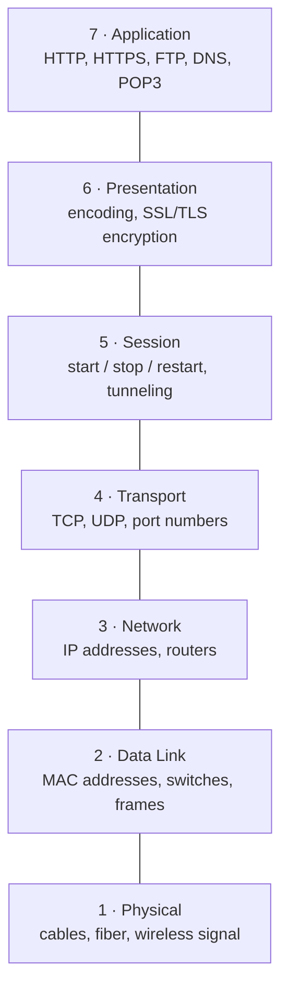
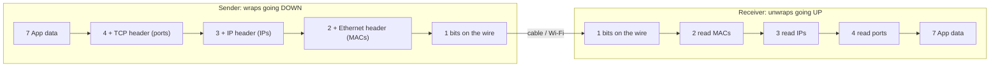

# Understanding the OSI Model

[← Back to index](../README.md)

**Source video:** [Understanding the OSI Model – Professor Messer](https://www.professormesser.com/network-plus/n10-009/n10-009-video/n10-009-training-course/) *(13:51)*

**Objective:** 1.1 (explain concepts related to the OSI reference model)

The OSI model is a 7-layer map of what happens to data as it moves across a network. You'll use it all through the course (and your career) to describe **where** something is happening or **where** a problem is.

---

## 1. What the OSI model is (and isn't)

**OSI = Open Systems Interconnection reference model.**

- It's a **model**: a way to *describe* networking, not a piece of software you install
- It's a **broad overview**, not a detailed spec of every bit
- It is **not** the protocol suite we actually run. Real networks run **TCP/IP**, but the OSI model still describes TCP/IP traffic just fine
- Each layer can have **many** protocols living in it (sometimes hundreds)

**Analogy:** A map of a building's floors. The map doesn't *move* anyone, but when someone says "the problem is on floor 3," everybody knows where to go.

**Why it matters:** It's a shared language. Say "that's a Layer 1 problem" to any IT person at any company and they know you mean cables or signal, not the app.

**Dev angle:** Like saying "it's a frontend bug" vs. "it's a database bug." The layers tell people where to look.

---

## 2. The 7 layers

| # | Layer | Nickname | Think of it as… |
|---|---|---|---|
| 7 | **Application** | what you interact with | The app on your screen |
| 6 | **Presentation** | encoding / encryption | The translator |
| 5 | **Session** | start / stop / restart | The phone call staying connected |
| 4 | **Transport** | the "post office" layer | TCP and UDP, ports |
| 3 | **Network** | the "routing" layer | IP addresses, routers |
| 2 | **Data Link** | the "switching" / MAC layer | MAC addresses, switches |
| 1 | **Physical** | signals | Cables, fiber, radio waves |

### Memory tricks

- **Top down (7 → 1):** **A**ll **P**eople **S**eem **T**o **N**eed **D**ata **P**rocessing
- **Bottom up (1 → 7):** **P**lease **D**o **N**ot **T**hrow **S**ausage **P**izza **A**way

> ⚠️ The exam will mix up the direction. Always check whether it's counting from the top or the bottom.

---

## 3. Layer 1: Physical

**What it is:** Raw signals moving across the medium: electricity on copper, light in fiber, radio waves for wireless. Almost no "protocols" here; it's just *can the signal get from A to B?*

**Analogy:** The road itself. If the road is washed out, it doesn't matter how good the driver is.

**Layer 1 problems look like:**
- Bad or unplugged cable, cracked fiber
- Wireless interference
- A dead network card

**How you troubleshoot it:** Cable testers, **loopback tests** (sending a signal out and back into the same device to prove the port works), swapping adapters.

**Dev angle:** "Is it plugged in?" is literally a Layer 1 question.

---

## 4. Layer 2: Data Link

**What it is:** How two devices on the **same local network** talk to each other directly, using **MAC addresses**.

- **MAC = Media Access Control** (not a Mac computer!)
- A MAC address is the **hardware address** of a network card (Ethernet or Wi-Fi)
- Also called the **DLC (Data Link Control)** address, or **EUI-48 / EUI-64** (Extended Unique Identifier, 48-bit or 64-bit)
- Data at this layer is packaged in **frames** (e.g., Ethernet frames)
- **Switches** forward traffic by destination MAC address, so this is the **switching layer**

**Analogy:** A name tag permanently sewn onto each device. Inside one building (the LAN), the mail carrier (switch) delivers by name tag.

**Example:** `3C:22:FB:9A:10:4E` in your Wi-Fi settings is your MAC address.

**Exam tip:** Anything about **MAC addresses, switches, or frames → Layer 2.**

---

## 5. Layer 3: Network

**What it is:** Moving data **between different networks** using **IP addresses**. Routers look at the destination IP to decide the next hop.

- This is the **routing layer**
- IP addresses and **subnet masks** live here
- **Fragmentation** happens here: if the next network only accepts smaller pieces, the data is split up and reassembled at the other end

**Analogy:** The street address on an envelope. The name tag (MAC) works inside one building, but to reach another city you need a full address (IP).

**Example:** Your laptop is `192.168.1.25` on your home network; Google's server has its own public IP. Your router uses those to send the request out.

**Exam tip:** Anything about **IP addresses, subnet masks, or routing → Layer 3.**

> 📝 Small accuracy note: the video describes fragmenting "frames." Technically, at Layer 3 it's IP **packets** that get fragmented. Same idea, just the more precise word.

---

## 6. Layer 4: Transport

**What it is:** Getting the data from one device to the other, reliably (or fast). Big data gets chopped into smaller pieces and reassembled on the other side.

- The two big protocols: **TCP** (Transmission Control Protocol) and **UDP** (User Datagram Protocol)
- **Port numbers** live here (e.g., TCP 443 for HTTPS)
- Nicknamed the **post office layer**

**Analogy:** The post office. It doesn't care what's in your letter; it just gets it there.

**Dev angle:** When you run `npm run dev` and it says `localhost:3000`, that **3000** is a Layer 4 port number.

**Exam tip:** Any mention of **TCP, UDP, or a port number → Layer 4.**

*(TCP vs. UDP in detail comes later in 1.4.)*

---

## 7. Layer 5: Session

**What it is:** Managing the **conversation** between two devices: **starting, stopping, and restarting** it.

- Control protocols that set up and tear down sessions
- **Tunneling** protocols (carrying one kind of traffic inside another) are often placed here

**Analogy:** A phone call. Dialing, staying connected, and hanging up are the session. What you *say* is the higher layers.

**Exam tip:** Keywords **"start / end / restart a session," "control protocols," "tunneling" → Layer 5.**

---

## 8. Layer 6: Presentation

**What it is:** Getting data into a format the app (and your eyes) can use.

- **Character encoding** (e.g., text formats)
- **Encryption and decryption** of application data (SSL/TLS)
- Often lumped together with Layer 7

**Analogy:** A translator who also unlocks the lockbox before handing you the letter.

**Dev angle:** HTTPS encryption (TLS) is what turns gibberish on the wire back into readable JSON for your app.

**Exam tip:** **SSL/TLS encryption → Layer 6** on the exam.

> 📝 In the real world people argue about which layer TLS belongs to. For CompTIA, go with **Layer 6**.

---

## 9. Layer 7: Application

**What it is:** The layer **you interact with**: the app and its messages on your screen.

- Protocols: **HTTP, HTTPS, FTP, DNS, POP3**, and thousands more

**Analogy:** The storefront. It's what the customer actually sees and touches.

**Dev angle:** Your React app calling `fetch("https://api.example.com")` is talking HTTP(S) at Layer 7. A `404 Not Found` is a Layer 7 message.

**Exam tip:** "Layer 7" does **not** mean the app's code itself. It means the network services the app uses (HTTP, DNS, etc.).

---

## 10. Real-world mapping cheat table

| If the question mentions… | Layer |
|---|---|
| Cables, fiber, signal, wireless signal | 1 |
| Ethernet frames, MAC address, EUI-48/EUI-64, switches | 2 |
| IP address, subnet mask, routers | 3 |
| TCP port, UDP port | 4 |
| Starting/ending sessions, control protocols, tunneling | 5 |
| SSL/TLS encryption, character encoding | 6 |
| The app itself: HTTP, FTP, DNS, POP3 | 7 |

---

## 11. Seeing the layers for real: Wireshark

**Wireshark** is a free tool that **captures network traffic** and breaks each frame into its layers. It has three panes:

1. **Top:** a list of captured frames, one per row
2. **Middle:** the selected frame broken into layers (this is the OSI model in action)
3. **Bottom:** the raw bytes in hex and ASCII

### Example: opening Gmail over HTTPS

When you expand one captured frame in the middle pane, each line maps to a layer:

| Wireshark line | What it shows | OSI layer |
|---|---|---|
| Frame | Bytes on the wire | 1 · Physical |
| Ethernet II | Source & destination **MAC** | 2 · Data Link |
| Internet Protocol | Source & destination **IP** | 3 · Network |
| Transmission Control Protocol | Source & destination **port** (dest **443**) | 4 · Transport |
| SSL/TLS | Encrypted session carrying the app data | 5, 6 and 7 |

Notice: **reading down the Wireshark list = climbing up the OSI layers.**

### Encapsulation (the "nesting dolls" idea)

Each layer **wraps** the data from the layer above with its own header, like putting a letter in an envelope, then in a box, then on a truck. The receiver unwraps in reverse.

**Analogy:** Russian nesting dolls. Each layer adds a doll on the way out and removes one on the way in.

**Try it yourself:** Install Wireshark, start a capture on your Wi-Fi adapter, open any HTTPS site, then filter with `tcp.port == 443`. Click a row and expand the middle pane.

---

## Extra (commonly tested): what the data is called at each layer

Not covered in this video, but the exam likes it. The chunk of data at each layer is a **PDU (Protocol Data Unit)**:

| Layer | PDU name |
|---|---|
| 4 · Transport | **Segment** (TCP) / **Datagram** (UDP) |
| 3 · Network | **Packet** |
| 2 · Data Link | **Frame** |
| 1 · Physical | **Bits** |

Memory trick (4 → 1): **S**ome **P**eople **F**ear **B**irthdays → Segment, Packet, Frame, Bits.

---

## What CompTIA is likely to test

- **Layer order and names** (both directions)
- **Device → layer:** hub = 1, switch = 2, router = 3
- **Address → layer:** MAC = 2, IP = 3, port = 4
- **Protocol → layer:** TCP/UDP = 4, SSL/TLS = 6, HTTP/DNS/FTP = 7
- **Problem → layer:** bad cable = 1, wrong IP = 3, app error = 7
- **Scenario questions:** "A technician finds a damaged cable. At which OSI layer is the problem?" → **Layer 1**

## Common traps

- ❌ **Mixing up top-down and bottom-up numbering.** Layer 1 is Physical (bottom), Layer 7 is Application (top).
- ❌ **"MAC" means Apple.** It's Media Access Control, a hardware address.
- ❌ **Putting ports at Layer 3.** IPs are Layer 3; **ports are Layer 4**.
- ❌ **Putting switches at Layer 3.** Standard switches = Layer 2. (Layer 3 switches exist and get covered later.)
- ❌ **Thinking OSI is what networks actually run.** We run TCP/IP; OSI is the reference model we *describe* it with.
- ❌ **Putting encryption at Layer 7.** For the exam, SSL/TLS encryption is **Layer 6**.

---

## Key Terms

### OSI Model
- **Term:** A 7-layer reference model describing how data moves across a network
- **Analogy:** A floor map of a building that everyone uses to say where a problem is
- **Example:** "That's a Layer 1 issue" = check the cable
- **Exam tip:** A model, not a protocol suite. Real networks run TCP/IP.

### Layer 1: Physical
- **Term:** The layer of raw signals over copper, fiber or radio
- **Analogy:** The road itself
- **Example:** A bad Ethernet cable or Wi-Fi interference
- **Exam tip:** Cables, signals, hubs. Troubleshoot with cable testers and loopback tests.

### Layer 2: Data Link
- **Term:** The layer for local device-to-device delivery using MAC addresses
- **Analogy:** A mail carrier delivering by name tag inside one building
- **Example:** A switch forwarding a frame to the right port
- **Exam tip:** MAC addresses, frames, switches. "Switching layer."

### Layer 3: Network
- **Term:** The layer that moves data between networks using IP addresses
- **Analogy:** The full street address that gets a letter to another city
- **Example:** A router choosing the next hop toward Google
- **Exam tip:** IP addresses, subnet masks, routers, fragmentation. "Routing layer."

### Layer 4: Transport
- **Term:** The layer that gets data from one device to another and handles ports
- **Analogy:** The post office
- **Example:** HTTPS traffic using TCP port 443
- **Exam tip:** TCP, UDP, port numbers. "Post office layer."

### Layer 5: Session
- **Term:** The layer that starts, manages and ends communication sessions
- **Analogy:** Dialing, holding and hanging up a phone call
- **Example:** A control protocol setting up a connection; tunneling
- **Exam tip:** Start / stop / restart, control protocols, tunneling

### Layer 6: Presentation
- **Term:** The layer that formats, encodes and encrypts/decrypts application data
- **Analogy:** A translator who also unlocks the lockbox
- **Example:** TLS decrypting HTTPS traffic so the page can display
- **Exam tip:** SSL/TLS encryption and character encoding → Layer 6

### Layer 7: Application
- **Term:** The layer of the network services users and apps interact with
- **Analogy:** The storefront customers see
- **Example:** A browser using HTTPS; DNS lookups; an FTP client
- **Exam tip:** HTTP/HTTPS, FTP, DNS, POP3

### MAC Address
- **Term:** Media Access Control address, the hardware address of a network card
- **Analogy:** A name tag sewn onto a device
- **Example:** `3C:22:FB:9A:10:4E`
- **Exam tip:** Layer 2. Not related to Apple Macs. Also called DLC address or EUI-48/EUI-64.

### EUI-48 / EUI-64
- **Term:** Extended Unique Identifier, standard formats for hardware addresses (48-bit and 64-bit)
- **Analogy:** Short and long versions of a serial number
- **Example:** A typical Ethernet MAC address is EUI-48
- **Exam tip:** Layer 2. Another name for MAC-style addresses.

### TCP (Transmission Control Protocol)
- **Term:** A Layer 4 protocol that delivers data between devices
- **Analogy:** Sending a package with tracking
- **Example:** HTTPS to a website over TCP 443
- **Exam tip:** Layer 4. Details in 1.4.

### UDP (User Datagram Protocol)
- **Term:** A Layer 4 protocol that delivers data between devices
- **Analogy:** Dropping a postcard in the mailbox
- **Example:** DNS lookups commonly use UDP
- **Exam tip:** Layer 4. Details in 1.4.

### Fragmentation
- **Term:** Splitting data into smaller pieces so it fits through a network, then reassembling it
- **Analogy:** Taking furniture apart to fit through a narrow door, then rebuilding it
- **Example:** A large packet split to cross a link that only allows smaller packets
- **Exam tip:** IP fragmentation happens at Layer 3

### SSL / TLS
- **Term:** Protocols that encrypt data between apps (TLS is the modern replacement for SSL)
- **Analogy:** A lockbox only the two ends have keys to
- **Example:** The padlock icon on an HTTPS site
- **Exam tip:** Layer 6 (Presentation) on the exam

### Encapsulation
- **Term:** Each layer wrapping the data from the layer above with its own header
- **Analogy:** Russian nesting dolls, or letter → envelope → box → truck
- **Example:** App data inside TCP inside IP inside an Ethernet frame
- **Exam tip:** Sender wraps going down; receiver unwraps going up

### PDU (Protocol Data Unit)
- **Term:** The name for a chunk of data at a given layer
- **Analogy:** The same cargo called a "package," "pallet" or "container" depending on where it is
- **Example:** Segment (L4), Packet (L3), Frame (L2), Bits (L1)
- **Exam tip:** "Some People Fear Birthdays"

### Wireshark
- **Term:** A free protocol analyzer that captures traffic and decodes it by layer
- **Analogy:** An X-ray machine for network traffic
- **Example:** Filtering `tcp.port == 443` to inspect HTTPS traffic
- **Exam tip:** A protocol analyzer / packet capture tool (more in 5.5)

### Loopback Test
- **Term:** Sending a signal out of a port and right back into it to confirm the hardware works
- **Analogy:** Talking into a microphone and hearing yourself through the speaker
- **Example:** A loopback plug on a network card or switch port
- **Exam tip:** A Layer 1 troubleshooting technique
